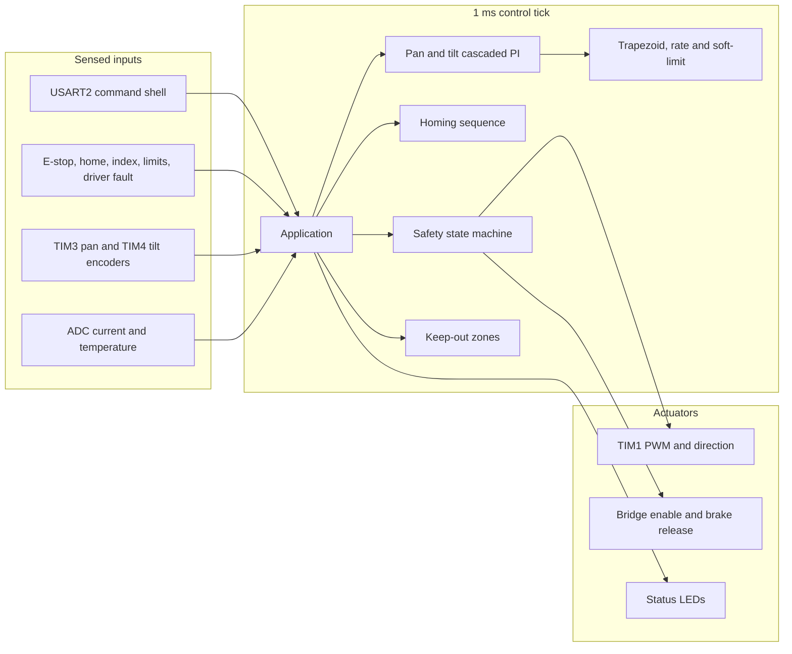
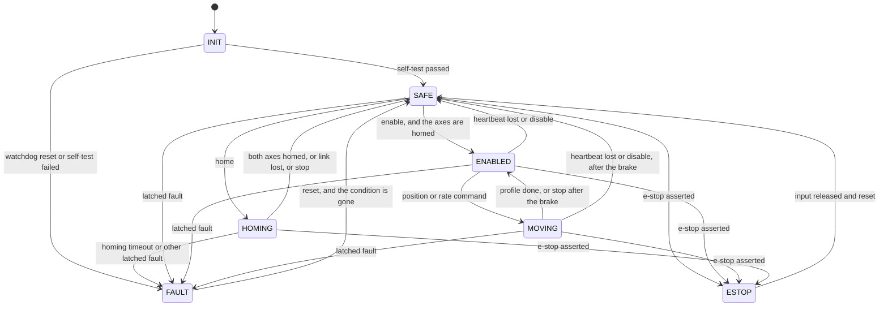

# Pan/tilt gimbal positioner

Bare-metal firmware for a two-axis pan/tilt turret (gimbal) motion controller on an STM32F407. It points the head: cascaded position and rate loops, homing, travel limits, keep-out zones, and a latched safety state machine. It does not actuate a payload. There is no release, cue, or enable path for anything except the two axis motors and their brakes.

The same C sources build as a Cortex-M4 image and as a host library. Register access goes through a CMSIS-style map on the target and through RAM stand-ins under `MC_HOST_BUILD`, so the control and safety code is unit-tested without a board. A Renode robot suite loads the real ELF and injects switches, a gate-driver fault, a frozen encoder, a lost heartbeat, and a long run of the independent watchdog.

## Architecture



The tick is 1 ms from SysTick. The main loop services that tick, kicks the independent watchdog, and then waits for the next interrupt. Motion math is C. The command parser and the keep-out geometry are C++17 without exceptions or RTTI. Drivers write peripheral registers directly. There is no STM32 HAL.

The CPU clock is the 16 MHz HSI. That keeps startup free of a PLL lock the simulator would have to model, and it is a legal 0-wait-state configuration.

## State machine

Axes stay in `SAFE` with the bridge off and the spring-applied brakes engaged until a homing sequence has completed. `ENABLED` holds the measured pose. `MOVING` tracks a position profile or a rate command. A lost heartbeat or `disable` is a controlled stop back to `SAFE`, not a latched fault. `stop` during a move brakes and returns to `ENABLED`.



E-stop cuts the bridge immediately, clears the homed flag, and stays latched until the input is released and `reset` is received. Reset while the input is still asserted does nothing. Overcurrent, an encoder glitch, a watchdog reset, and a failed self-test also drop the bridge on that tick. Overtemperature, stall, a hard limit, a keep-out violation, and a failed home decelerate under the rate loop, then de-energize and engage the brakes. Every fault stays latched until `reset`, and `reset` is ignored while the condition is still present.

## Safety requirements

The host test process fails if any id below was not executed. Renode covers the rows marked in the last column by running the firmware ELF.

| Id | Requirement | Code | Host test | Renode |
| --- | --- | --- | --- | --- |
| SR-ESTOP-1 | E-stop forces `ESTOP`, bridge off, brakes engaged | `enter_estop` | `test_safety.cpp` | e-stop press |
| SR-ESTOP-2 | Releasing the input does not clear the latch | `mc_safety_step` | `test_safety.cpp` | release without reset |
| SR-ESTOP-3 | `reset` while the input is asserted is ignored | `mc_safety_step` | `test_safety.cpp` | reset while held |
| SR-ESTOP-4 | E-stop clears the homed flag | `enter_estop` | `test_safety.cpp` | enable refused after reset |
| SR-OC-1 | Overcurrent or a gate-driver fault drops the bridge | `enter_fault` | `test_safety.cpp`, `test_app.cpp` | pan driver-fault input |
| SR-OT-1 | Overtemperature latches and brakes before cutoff | `enter_fault` | `test_safety.cpp`, `test_app.cpp` | host only; Renode has no ADC converter |
| SR-ENC-1 | An encoder glitch latches, cuts the bridge, and clears homed | `enter_fault` | `test_safety.cpp` | host |
| SR-STALL-1 | Commanded effort with no motion latches and brakes | `axis_stalled` | `test_safety.cpp` | `rate` with a frozen encoder |
| SR-LIM-1 | A hard limit while energized latches and brakes | `sample` in `app.c` | `test_safety.cpp` | tilt limit after enable |
| SR-LIM-2 | Soft limits reject commands and cap speed before the stop | `mc_limit_velocity` | `test_trajectory.cpp`, `test_app.cpp` | host |
| SR-KO-1 | A command whose segment enters a keep-out zone is rejected | `mc_keepout_segment_hits` | `test_keepout.cpp`, `test_app.cpp` | host |
| SR-KO-2 | A measured pose inside a keep-out zone latches | `mc_safety_step` | `test_safety.cpp` | host |
| SR-HOME-1 | `enable` is refused until both axes have homed | `handle_line` | `test_safety.cpp`, `test_app.cpp` | `enable` at boot |
| SR-HOME-2 | Home switches zero tilt, then pan, and set homed | `mc_homing_step` | `test_homing.cpp` | scripted home switches |
| SR-HOME-3 | A homing timeout latches `HOMING` | `mc_homing_step` | `test_homing.cpp` | host |
| SR-HB-1 | Losing the heartbeat stops in a controlled way, without a latched fault | `mc_safety_step` | `test_safety.cpp`, `test_app.cpp` | silence after enable |
| SR-WDG-1 | A watchdog reset enters `FAULT` until `reset` | `mc_safety_step` | `test_safety.cpp` | host; the model does not set `IWDGRSTF` |
| SR-WDG-2 | The foreground loop kicks the watchdog, and a missed kick resets the core | `mc_iwdg_kick` | `test_drivers.cpp` | still `SAFE` after 35 s |
| SR-RST-1 | `reset` clears a latched fault once the condition is gone | `mc_safety_step` | `test_safety.cpp` | host |
| SR-RST-2 | `reset` is ignored while the condition remains | `mc_safety_step` | `test_safety.cpp` | host |
| SR-BRK-1 | Non-immediate faults brake, then de-energize | `enter_fault` | `test_safety.cpp`, `test_app.cpp` | host |
| SR-MOVE-1 | A position or rate command is accepted only when enabled or already moving | `mc_safety_step` | `test_safety.cpp` | `rate` after enable |
| SR-RATE-1 | The trapezoid respects the rate and acceleration limits | `mc_trap_step` | `test_trajectory.cpp` | host |
| SR-PAN-1 | Pan is limited by default and can be switched to continuous | `mc_axis_init`, `mode` | `test_axis.cpp` | host |

## Motion

Each axis has a motor PWM channel, a direction pin, a bridge-enable pin, a brake-release pin, and a quadrature encoder. The position loop commands a rate. That rate is acceleration-limited, then capped so it can stop before a soft travel limit (`v <= sqrt(2 a s)`). The rate loop commands duty cycle with conditional integration. A position command builds a trapezoid: desired speed is the minimum of the rate limit and the stopping speed for the remaining distance, then slewed by the acceleration limit.

Default travel, before any `limits` command:

| Axis | Soft travel | Rate limit | Acceleration |
| --- | --- | --- | --- |
| Pan | -170° to +170°, or continuous via `mode pan continuous` | 120 °/s | 360 °/s² |
| Tilt | -45° to +90°, always limited | 80 °/s | 280 °/s² |

Encoders are 4096 counts per revolution. Angles wrap with a half-open range of [-180°, 180°) when pan is continuous. Up to four axis-aligned keep-out rectangles can be added. A command is rejected when the target, or the straight segment from the measured pose to the target, meets a rectangle. Pan segments that cross the ±180° cut are tested in two pieces.

Homing runs tilt, then pan. Each axis seeks in the negative direction, creeps off the home switch, and zeros on that edge. `index on` waits for the encoder index after the switch opens. A phase that exceeds 8 s latches a homing fault. The axes cannot enter `ENABLED` until homing has succeeded, including after e-stop, which clears the homed flag.

## Command shell

USART2, 115200 8N1. Lines end in newline. Carriage return is ignored.

| Command | Effect |
| --- | --- |
| `help` | List commands. Counts as a heartbeat. |
| `status` | `OK state=... act=... homed=... fault=... phase=... pan=... tilt=...` |
| `hb` | Heartbeat. The link times out after 500 ms. |
| `home` | Start homing from `SAFE`. |
| `enable` / `disable` | Hold the pose, or brake and return to `SAFE`. |
| `stop` | Brake a move and hold. |
| `reset` | Clear a latched fault or e-stop when the input allows it. |
| `pos <pan> <tilt>` | Trapezoidal move, degrees. |
| `rate <pan> <tilt>` | Rate command, degrees per second. |
| `mode pan limited` or `mode pan continuous` | Pan travel mode. |
| `limits pan\|tilt <min> <max>` | Soft travel, min strictly less than max. |
| `zone add <pmin> <pmax> <tmin> <tmax>` | Keep-out rectangle. Refused if it contains the current pose. |
| `zone clear` | Remove keep-out zones. |
| `kp` / `ki` `pos\|rate` `pan\|tilt <value>` | Non-negative gain. |
| `index on\|off` | Use the encoder index as the zero edge. |

Replies are `OK ...` or `ERR parse`, `ERR state`, `ERR not-homed`, `ERR limit`, `ERR keep-out`. State changes also emit an `EVT` line with the same fields as `status`. The boot line is `BOOT pan-tilt-gimbal`.

## Electrical assumptions

Active level is high for every sensed input. The e-stop pin (PC0) has a pull-up: the external safety loop holds it low while healthy, so an open wire is an e-stop. Home, index, limit, and gate-driver fault inputs have pull-downs, so an open wire is not a trip. Current sense is midscale at 1.65 V = 0 A, 0.132 V/A, trip at 8 A. Temperature is 10 mV/°C with 0 V = 0 °C, trip at 80 °C. A conversion that does not complete keeps the previous sample (0 A and 25 °C at boot), so a missing converter does not false-trip. The Renode ADC is not a converting model; overcurrent in that suite is the gate-driver fault pin.

PWM is 20 kHz on TIM1 CH1 (pan) and CH2 (tilt). Direction is a GPIO, not a signed duty. Brake release is high. Low engages the spring-applied brake.

| Function | Pin |
| --- | --- |
| Pan / tilt current, temperature | PA0, PA1, PA4 |
| USART2 TX / RX | PA2, PA3 |
| Pan encoder A / B | PA6, PA7 (TIM3) |
| Pan / tilt PWM | PA8, PA9 (TIM1 CH1 / CH2) |
| Pan index, home, limit min, limit max | PB0, PB1, PB2, PB3 |
| Tilt encoder A / B | PB6, PB7 (TIM4) |
| Tilt index, home, limit min, limit max | PB8, PB9, PB10, PB11 |
| E-stop | PC0 |
| Pan direction, enable, brake release | PC1, PC2, PC4 |
| Tilt direction, enable, brake release | PC5, PC6, PC7 |
| Pan / tilt gate-driver fault | PD0, PD1 |
| Heartbeat, enabled, fault, moving LEDs | PD12, PD13, PD14, PD15 |

The independent watchdog uses the 32 kHz LSI, prescaler /256, and a full reload. That is about 32 s. Only the foreground loop kicks it. The Renode model does not set `RCC_CSR.IWDGRSTF`, so the reset-cause latch is a host test. The simulator test runs longer than the watchdog period and checks that the core did not reboot.

## Build, test, and flash

Host tools: CMake, Ninja, GCC, and G++. Firmware tools: `arm-none-eabi-gcc` 13 or newer. Tests use GoogleTest 1.15.2, fetched at configure time. Warnings are errors, including conversion and double-promotion. The image must stay within 96 KiB of flash and 64 KiB of RAM (`tools/size_budget.py`).

```sh
cmake -S . -B build/host -G Ninja -DCMAKE_C_COMPILER=gcc -DCMAKE_CXX_COMPILER=g++
cmake --build build/host
ctest --test-dir build/host --output-on-failure
sh tools/cppcheck.sh

cmake -S . -B build/fw -G Ninja -DCMAKE_TOOLCHAIN_FILE=cmake/toolchain-arm-none-eabi.cmake
cmake --build build/fw
python3 tools/size_budget.py build/fw/gimbal.elf

sh tools/install_renode.sh /opt/renode
export PATH="$HOME/.local/bin:$PATH"
renode-test tests/renode/gimbal.robot
```

Flash the binary at `0x08000000`. Continuous integration does not attach a probe.

```sh
st-flash write build/fw/gimbal.bin 0x08000000
```

```sh
openocd -f board/stm32f4discovery.cfg -c "program build/fw/gimbal.elf verify reset exit"
```

A devcontainer in `.devcontainer/` installs the host compiler, the cross compiler, cppcheck, OpenOCD, stlink, and Renode 1.17.0. GitHub Actions runs the host tests, cppcheck, the firmware size budget, and the Renode suite.

## What I learned

This section is for the person who owns the repository. Leave the prompts below and fill them in after building, flashing, and breaking the controller.

- The bug that took the longest to find:
- What the host tests caught that the simulator did not:
- What the simulator caught that the host tests did not:
- A safety requirement I would add or tighten:
- What I would change in the pinout or the loop rates after running on hardware:
